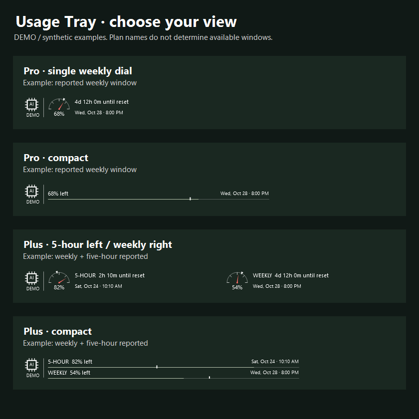

# Usage Tray

Free, local-first Windows Codex allowance meter. **Experimental Windows portable preview.** Download the ZIP from [Releases](https://github.com/nsileo77/usage-tray/releases). Independent utility, not affiliated with or endorsed by OpenAI.



Standard dials or compact lines, optional original AI symbol, configurable labels/sections, abbreviated local reset dates and white even-use pacing markers. Error/stale status stays visible. Plan labels in screenshots are illustrative: available windows come from the source, never the plan name.

This measures Codex allowance, not all ChatGPT message usage. It reads the existing signed-in official Codex client using `account/rateLimits/read`. Only reported five-hour/weekly windows are displayed; other windows are detailed separately. Missing data remains unavailable. Remaining is clamped 100 minus usedPercent; duration is in minutes and reset timestamps are Unix seconds. Pace uses actual duration and reset metadata; missing metadata suppresses the notch.

## Build and test
On Windows with the .NET Framework 4.x compiler, WinForms and WPF installed:
```powershell
& .\source\Build.ps1
Start-Process .\UsageTray.exe -ArgumentList '--self-test' -Wait
Get-Content .\test-result.txt
Get-Content .\layout-tests.txt
```
Do not disable execution policy or other protections to run the scripts. Review local policy if execution is blocked.

## Run / remove
Extract a reviewed release ZIP into a user-owned folder or build from source. Run `UsageTray.exe`; use an already-signed-in official Codex client. The app does not install/start login, collect credentials or add automatic startup. The review stores display preferences only in `%LOCALAPPDATA%\UsageTrayReview` and uses a separate review mutex. Do not overwrite another installation. Use the details dialog to choose an existing trusted official codex.exe if discovery fails.

Right-click for standard/compact switching or Quit. Display preferences are in details. To remove: Quit, delete the extracted application folder, and optionally remove only `%LOCALAPPDATA%\UsageTrayReview` to erase this review's preferences. Leave Codex and other Usage Tray settings untouched. No installer/uninstaller is supplied; portable operation is the initial distribution. Clean-machine verification remains pending.

## Privacy and limitations
No utility telemetry, backend, signup, quota upload or credential files. The official client communicates with its service and may maintain its own local state under its own terms. Account identity is compared in memory before and after reads; failed/account-changing reads clear the shown snapshot. The UI refreshes every 60 seconds. Screenshots use synthetic data.

The official [migration documentation](https://learn.chatgpt.com/docs/mcp-server) calls app-server experimental and unsupported for production workloads (checked 2026-10-24). The auth guidance permits existing local/open-source apps; the experimental status concerns reliability/support. This utility remains free and local; commercial/hosted use requires reassessment. See RELEASE-PLAN.md and ATTRIBUTION.md. Automated taskbar/DPI/recovery tests passed and the owner approved the live display on the development laptop. Compatibility on other machines remains unverified; a floating fallback exists. Builds are unsigned. Windows/SmartScreen may warn or block them; do not weaken security protections to run the preview.

## License
[MIT License](LICENSE), copyright (c) 2026 Nicholas Sileo. Free to use, modify and redistribute under its terms. This licenses Usage Tray source and included original assets; it does not license OpenAI services, Windows or other external dependencies. Source and portable preview are distributed separately; see Releases for available downloads.


## Logo choices
In Display preferences, use the original AI symbol, uncheck **Show logo**, or choose a local PNG/JPEG/BMP. Images must be at most 4 MB and 4096 pixels per side. Unsupported, missing or corrupt images fall back to the AI symbol. The image path is saved only in local review preferences; the image is not uploaded, copied into the application, or included in this repository. Default-logo and display-preset controls can reset that choice. Error/stale indicators remain visible independently.

The previously verified live account returned weekly data only. Five-hour data is displayed only when actually reported; plan names in screenshots are synthetic examples, not promises of availability.

## Reset display and review status
Standard dials show the countdown above a local reset such as `Sun, Nov 1 · 4:57 AM`. Period labels appear only when both windows are displayed. Full date, year and timezone details remain in the tooltip/details. If an older review preference disabled the countdown, enable Relative countdown in Display preferences. The preview uses the existing review settings namespace and does not modify another installation.

The owner reviewed the running corrected build on 2026-10-25. Automated checks cover parsing, account isolation, unavailable/stale/error states, DST/year rollover, logo validation, layout options, 100/125/150/200% rendering, taskbar attachment and recovery. This is not a claim of clean-machine or all-Windows compatibility testing.
